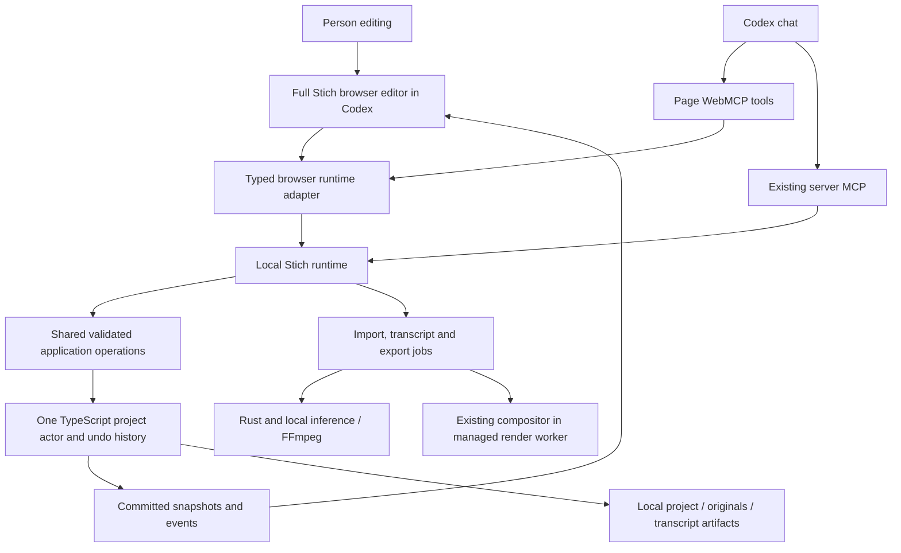

# Stich inside Codex: implementation plan

Date: 5 October 2026. Status: first private Mac MVP installed on `codex/stich-browser-mvp`; broader acceptance gates remain open. See [observed implementation and evidence](MVP.md).

This plan follows Osiris's three interview rounds. Requirements are settled for the first workflow. Technical recommendations below still need the specified feasibility checks. The inspected runtime is the private WeftCut 0.3.0 fork at `ccee07c9`; subsequent planning commits contain documentation only.

## What we are building

A full Stich editor in Codex's built-in browser, beside the chat, running on this Mac. A person or Codex can open/create a project, find and import a recording, place it on the timeline, transcribe it locally, remove spoken sections by selecting transcript words, adjust those cuts, save and export a raw-trimmed MP4.

The application supplies editing capabilities. The person and agent decide the editorial process in their conversation. There is no compulsory automatic trimming recipe, default content-removal policy or second AI chat inside Stich. Every included editing capability has both a useful human control and an agent tool.

## Why it matters

Osiris already knows how to trim a spoken video by reading its transcript. The goal is to preserve that clear workflow while letting Codex handle mechanical work and authorized edits in the same visible project. His reported baseline is about 30 minutes for his own 5–10 minute recording and about an hour for another person's. We will measure time and output quality against that baseline, rather than promise an untested speed multiplier.

## What the finished experience will feel like

1. Launch Stich and choose **Open in Codex**. Its full timeline, preview, media pool and editing transcript appear beside the conversation. Runtime startup and connection readiness are visible.
2. Ask Codex to find a recording in a chosen folder and create/import into a project, or use the same project/file controls manually. Preparation progress identifies what is ready for playback and transcription.
3. Generate a transcript. English remains English; spoken Hindi appears in Roman letters as Hinglish. This is transcription and Romanization, not translation into English.
4. Selecting transcript words highlights the corresponding footage. **Cut selection** removes that footage and closes the gap. **Correct text** only fixes spelling; it does not cut or replace speech.
5. Play around the boundary. Nearby controls move either trim edge to keep more footage or remove more. Restore and undo recover both the video and its transcript appearance.
6. Give the agent any appropriate editing instruction in chat. Its changes appear in this same editor and remain manually adjustable. Agent work does not switch away from the full timeline.
7. Save the editable project. Export an MP4 containing the rough cut for the next editor, with no compulsory captions, graphics or music. Originals remain intact.

These describe the intended product, not features already delivered by the installed app.

## Included and deferred

| First delivery | Later work |
| --- | --- |
| This Mac, English/Hindi code-switching, Roman Hindi display | Team access, VPS processing, remote media and collaboration |
| Main spoken recording, normal-speed linked video/audio transcript cuts | General transcript mapping through arbitrary nested groups and retiming |
| Full timeline for manual use; tools for the complete agreed workflow | New effects, automatic B-roll, captions and creative finishing |
| Project/folder management, import, playback, save, raw-trimmed MP4 | Premiere/Resolve interchange or cloud recognition |
| Local open-source recognition, correction, precise adjustment, restore | A separate embedded AI agent or paid API dependency |

Existing editor features remain available where supported. The new transcript-cut operation must explicitly explain unsupported arrangements rather than silently damage them. This scope limits new transcript behavior; it does not replace the whole editor with a single-track screen.

## Infrastructure and technology changes

Yes, source changes are required. This is an extension of the current architecture, not a switch from TypeScript to Rust or a rewrite of the media engine.

| Technology | Keep | Build or change |
| --- | --- | --- |
| React + TypeScript | Timeline, panels, media pool, application state and history | Browser runtime adapter, editing-transcript panel, common commands and job controls |
| Electron + existing localhost Express host | Local app lifecycle, project actor, native module loading and current MCP connection | Serve the browser editor and scoped API/media/event routes; support browser-first launch |
| Rust + napi-rs | Media jobs, audio preparation/mixing, native decoding and encoding interfaces | Extend contracts only where required; persist matching schema changes and expose job progress |
| Pixi + browser media APIs | Existing compositor and compatible decoding code | Prove preview in the installed browser; use compatible local proxies when required |
| FFmpeg | Probe, convert, encode and mux media | Reuse jobs for compatible previews and runtime-owned MP4 export |
| Local Whisper.cpp candidate | Existing sidecar integration and Mac acceleration build path | Benchmark multilingual models, normalize source word timing and add local Romanization |
| MCP + WebMCP | Existing server tools and project mutations | Shared operations exposed on the live editor page; fill project, transcript, playback and export gaps |
| Local project files | Project JSON, media, caches, backups | Versioned source transcript artifacts, cut records and recoverable migrations |

No database server, hosted backend or account system is required. The VPS remains private source/development infrastructure. The initial browser version still uses an Electron runtime on the Mac; opening it in a browser does not automatically make its installer or memory footprint smaller.

## Architecture

The browser displays and requests changes. The runtime owns projects, accepted jobs and filesystem access. The actor owns committed edits. Rust performs media computation. Both tool transports and human controls use the same commands; none maintains a second timeline.

Opening today's Vite development URL alone will not achieve this: the renderer depends on Electron preload APIs, a custom media protocol and native frame transport. Those dependencies need real adapters. Export also needs extraction from its current React-owned flow into a runtime-owned job; a simple FFmpeg concatenation would bypass the existing compositor.

The first integration route is a top-level localhost page, matching the working Canvas pattern. Official [WebMCP documentation](https://learn.chatgpt.com/docs/webmcp) describes page tools in the built-in browser; page tools depend on that page being available. Keep [server MCP](https://learn.chatgpt.com/docs/extend/mcp?surface=cli) for runtime/job access when the editor is closed. Do not depend on unverified embedded widget support.

## Transcription and editing contract

Target usable-transcript time is **at most the recording's duration**, or real-time factor ≤1 on this Mac. A ten-minute recording should be ready in about ten minutes. This is a target to benchmark, not a guaranteed result. Measure from accepting transcription on imported media to a usable Roman transcript; report extraction, recognition, normalization/Romanization and timing work separately. Record import preparation separately too.

Use a multilingual local model, beginning with Base/Small comparisons through the existing Whisper.cpp integration. Larger models are an option only if measurements justify their cost on an 8 GB Mac. [Whisper.cpp documents Apple Silicon support and experimental word-level timestamps](https://github.com/ggml-org/whisper.cpp). Runtime support does not establish mixed-language accuracy or exact cut boundaries; the evaluation must listen to real cut samples.

Keep recognized text, display/corrected text and source timing distinct. Romanization retains word/source identities. Text correction changes spelling only. Cuts reference surviving occurrences of stable source words; they do not operate on character offsets or continually rewritten timeline timestamps. Timing adjustment is a separate action with audition controls. See [the transcript model](TRANSCRIPT-MODEL.md).

Local recognition has no paid service or silent cloud fallback. Model installation can require an explicit download. Codex remains the user's external agent; Stich is not claiming Codex itself runs offline.

## Delivery order and acceptance

First prove browser playback and local transcription on this Mac. If either fails, document the result and revise that technical choice before building the full editor around it. Then deliver shared commands and persistence, the browser editor, transcript cuts, fine adjustment and export in usable increments.

The full [delivery plan](DELIVERY.md) lists ten implementation tickets, dependencies, tests and release checks. [Architecture](ARCHITECTURE.md) defines runtime/preview/export boundaries. [Tool contracts](TOOLS.md) map human controls to agent operations and recovery behavior. [SESSION.md](SESSION.md) preserves the interview record.

Done means a person and Codex can each complete the agreed journey on the same project, the MP4 plays correctly with synchronized sound, spelling correction leaves footage unchanged, cuts are recoverable, retry/reconnect does not duplicate work, and the packaged app works on this Mac. Record exact commit/artifact, measured timings and any limitations. The current official WeftCut installation and its original project remain separate.

## Current handoff

This deliverable is the implementation plan, domain documentation and ordered local tickets. No application code, installed app or video project was changed. Review the product interpretation here before implementation; the first engineering step is the two feasibility tickets, not a wholesale rewrite.
