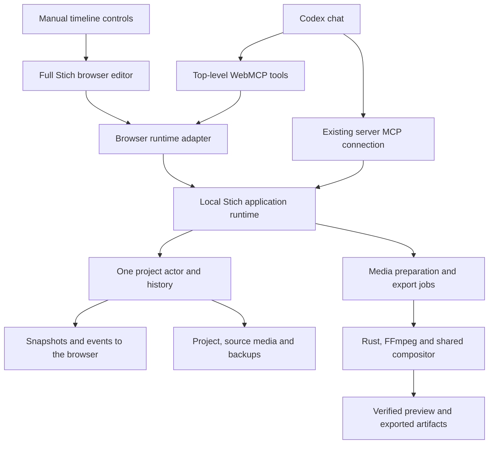

# Stich inside Codex: design session

Status: interviewing. Product direction is recorded; architecture and implementation remain proposals.

Session date: 5 October 2026, Asia/Kolkata.
Inspected source: `75276948`, private Stich branch based on WeftCut 0.3.0.

## What we are building

Osiris wants the full Stich timeline editor beside the Codex chat, like Canvas in the built-in browser. He can edit manually or describe an outcome to Codex. Both should work on the same saved project. AI should have useful application tools for the complete agreed workflow.

This session is design work. No runtime, connector, installed application, or video project is being changed. Implementation starts after Osiris has reviewed the proposed solution and confirmed shared understanding.

## Why this matters

Osiris has seen Codex operate Stich by clicking the desktop UI. He wants predictable application control and a small learning curve: ask for an editing result, watch the actual timeline change, review the video and keep working in Codex. His Canvas example establishes the interaction pattern: a full application with tools available to the agent on the live page.

The aspiration that AI can do the work 10 to 20 times better is a hypothesis to evaluate. Access to tools can reduce mechanical work; quality also depends on editorial judgment, usable media information, tool completeness and verification of the finished video.

## Confirmed product decisions

| Decision | User's answer | Consequence |
| --- | --- | --- |
| Where the first version runs | This Mac first; team/VPS support later | Media preparation and rendering stay on this Mac. The VPS remains source/development infrastructure for this version. |
| What appears beside the chat | The full timeline editor | A preview-only review card does not satisfy the requested experience. Reuse the timeline, media pool, preview, inspector, history and export controls. |
| How AI should interact | Canvas-style tools and possibly better tools | Tool support is part of the application design. Making buttons available in a browser alone is insufficient. |
| How to design | Ask questions, discuss answers and iterate until satisfied | Do not silently fill in editorial, autonomy or workflow requirements and begin coding. |
| First editing workflow | Import the main recording and trim by editing its transcription, like Osiris's described Premiere workflow | Transcript editing is the first product outcome. General creative finishing is later. |
| Cut control | Removing words trims the video; trim controls can shorten a cut or restore a little footage | Text selection and precise timeline adjustments must remain synchronized and reversible. |
| Project management | AI can open/create/start projects and manage/move project folders | Include project lifecycle tools. Define folder scope, identity and media-reference behavior before implementation. |
| Journey completeness | Yes to the whole journey | Plan opening/import, playback, transcript edits, save and output handoff. The handoff format is still a question. |
| Next person in the workflow | Another video editor receives the trimmed video and finishes editing | Optimize the first version for a useful rough-cut handoff. Do not add automatic graphics, music or captions to this scope. |

These are user decisions. The technology choices below are recommendations pending feasibility evidence and discussion.

## What the finished experience could look like

1. Start Stich's local runtime and open its editor beside the Codex chat.
2. Open or create a project. The timeline, preview and agent context identify the same project.
3. Add the main recorded video to the timeline and generate its editing transcript.
4. Read and select words, sentences or sections. Removing text removes the corresponding audio/video section and closes the cut. The expected default is immediate, undoable editing, matching the described workflow.
5. Play around a cut and adjust its boundaries to keep more footage or shorten it. The transcript, video and timeline must stay synchronized.
6. Ask Codex to perform project management or a specific edit. Whether it also chooses an initial rough cut is being discussed.
7. Save the editable project and produce the agreed handoff for another video editor.

The first version should not require installing an extra agent, entering a second chat interface, learning transport configuration or moving videos to a remote server. A local runtime is still necessary for native processing.

## Current facts and what they mean

| Observed fact | Evidence | Design consequence |
| --- | --- | --- |
| The editor is Electron, React and TypeScript with Rust native modules | `apps/desktop/package.json`, `src/main/index.ts`, `native/` | A browser frontend can reuse substantial UI code. Rust does not determine whether the interface can run in a browser. |
| The TypeScript actor owns project changes | `src/main/state/actor.ts`, `ts-actor-host.ts` | Retain one authoritative project. Browser, desktop and AI adapters should call the same validated operations. |
| Renderer bridge wrappers already exist | `src/renderer/bridge/ipc.ts`, `events.ts`, `fs.ts` and related files | There is an existing seam for a browser adapter, but direct `window.api` calls also need an inventory and migration. |
| File URLs use a custom Electron protocol | `bridge/ipc.ts`, Electron media-protocol tests | Ordinary browser media URLs need authenticated HTTP endpoints with range support and scoped asset identities. |
| Native frame transport uses Electron facilities | `src/preload/index.ts`, decoder `GpuTransport.ts` and `SwTransport.ts` | Opening the current Vite URL will not supply native frame transport. A browser preview path must be proved. |
| Export is orchestrated by a React hook and worker | `app/useExportFlow.ts`, `render/worker/runExport.ts` | Extract a reusable export job interface. Rendering still needs the existing compositor and native processing. |
| MCP already runs on authenticated loopback HTTP | `src/main/mcp/index.ts`, `bind.ts`, `auth.ts` | A local host already exists. Keep its authenticated MCP connection and investigate serving the browser workspace from the same runtime. |
| The recorded app catalog exposes many timeline edits | `stich-mcp-tools.txt`, source tool definitions | MCP requests are structured operations. The connector itself does not click UI controls. |
| The shipped skill explicitly sends video export to the UI | `skills/stich/SKILL.md`, `docs/mcp.md` | End-to-end AI export requires a deliberate contract change. Add tools, implementation, skill guidance and checks together. |
| Source-frame and Motif resources already exist | `src/main/mcp/hostResources.ts` | Reuse existing media reads. Source frames alone do not verify the final assembled composition. |
| Canvas currently exposes tools in the built-in browser | Read-only inspection of the existing Canvas tab on 5 October | The requested interaction pattern works in this installed host. No Canvas content was changed. |
| Current transcript application creates caption cues | `src/main/state/mutations/textCorrection.ts`, `mcp-commands.ts`, `src/renderer/speech/transcribeRun.ts` | Build an editing-transcript document and cut mapping. Do not represent transcript deletion as caption deletion. |
| Linked trim and ripple operations already exist | `src/main/state/mutations/trim.ts`, `docs/mcp.md`, `src/main/state/actor.ts` | Reuse validated edit behavior where possible, with one coherent audio/video cut and history action. |
| Transcript results distinguish timing provenance | `docs/adr/0036-pluggable-speech-backends-normalized-transcript.md`, native speech parsers | Engine-supplied word times remain estimates of acoustic boundaries. Cue-interpolated times need extra care before word cuts. |

Source paths in this table are relative to `apps/desktop` unless otherwise stated. Tool availability can differ by chat, connection and page lifetime. UI clicking can be deliberate visual verification, a missing operation or an unavailable connection; it does not by itself establish which one occurred.

## Codex integration options

### Recommended first route: a top-level localhost editor with WebMCP

Serve a browser build of the full editor from the local Stich runtime. Register the application's tools in the top-level document. The browser and Codex see the same project and selection. Reuse the current authenticated server MCP connection for operations that should remain available after the page closes.

Both transports should expose adapters for the same application operations. They must not maintain independent timelines or duplicate business rules.

Official [Site tools documentation](https://learn.chatgpt.com/docs/webmcp) describes WebMCP tools in the built-in browser, shared live-page context and support for both WebMCP and server MCP. It currently requires JavaScript registration in the top-level page; iframe tools and declarative form tools are not discovered. Site tools depend on the page remaining available and host support. The installed Canvas tab supplies a concrete compatibility example.

Official [Browser documentation](https://learn.chatgpt.com/docs/browser) documents local development URLs and showing the page beside chat. This route does not require modifying Codex itself.

### Optional later route: a plugin with an embedded review interface

The official [MCP server and UI quickstart](https://developers.openai.com/plugins/build/app-quickstart) documents MCP tools for ChatGPT and Codex and optional component UI in ChatGPT. [Troubleshooting](https://developers.openai.com/plugins/deploy/troubleshooting) explicitly limits its widget behavior guidance to ChatGPT. We should verify the installed host's embedded UI behavior before treating this as a delivery route for the full editor. A browser workspace already matches Osiris's example.

### Keep server MCP available

Official [MCP documentation](https://learn.chatgpt.com/docs/extend/mcp?surface=cli) documents local STDIO and Streamable HTTP connections. Retaining the existing connection can let Codex inspect jobs and results without depending on a visible tab. The plan must define which transport owns each session so duplicate connections do not duplicate work or retain history locks.

## Proposed architecture to evaluate



The recommendation is to keep the existing packaged runtime initially. It can host the project actor, native modules and a hidden rendering worker while serving a separate browser UI. This avoids an immediate engine rewrite. It also retains Electron's footprint, so a smaller installer or memory reduction is not an automatic benefit.

Browser preview should first test compatible source/proxy playback with browser decoding and the existing composition logic. Electron's shared GPU textures cannot simply be sent to an ordinary page. If browser decoding is inadequate on this Mac, evaluate a bounded native-to-browser transport using the same fixture. Do not pick a transport before measuring picture correctness, audio sync, seek time and memory.

Export should become a runtime-owned job using the current compositor and native encoding path. The browser should observe it rather than own its lifetime. Closing or reloading the browser must not silently cancel or corrupt an accepted export. A hidden Electron renderer is a proposed first implementation, not a completed headless export capability.

File operations need a scoped local interface. Do not expose every IPC channel or arbitrary filesystem path over HTTP. Media uses asset identities, bounded reads and range responses. Browser authentication should use its own scoped session rather than exposing the MCP bearer token. The exact launch/session mechanism is an engineering feasibility question.

## Design tree and current frontier

```text
Confirmed: this Mac first + full timeline beside chat + tools for AI
|
+-- Transcript-driven trim of the main recording [settled]
|   +-- Who selects removals? [Round 2, Q1]
|   +-- Languages and writing system? [Round 2, Q2]
|   +-- Transcription locality and quality trade-off? [Round 2, Q4]
|   +-- Word timing, text corrections, pauses and adjustable cut boundaries
|
+-- Codex handles the complete journey [settled]
|   +-- Open/create, import, play, save, manage project folders
|   +-- Editorial autonomy is distinct from mechanical control [Round 2, Q1]
|
+-- Rough cut goes to another video editor [settled]
|   +-- MP4 or editable interchange? [Round 2, Q3]
|   +-- Recipient's editing software [dependent on editable handoff]
|
+-- Baseline: 5 to 10 minute recordings [settled]
    +-- Around 30 minutes editing own recording; around 60 minutes someone else's
    +-- Readiness and editing-time target [needs agreement after engine sample]
    +-- Source preservation, undo and original-project recovery

After those answers
+-- Compare architecture choices and measured feasibility
+-- Settle contracts, delivery order and exclusions
+-- Review complete solution with Osiris
+-- Write implementation tickets and acceptance instructions
+-- Begin implementation only after shared understanding is confirmed
```

### Round 1 questions

1. Which complete editing job should become effortless first? Recommendation: clean a long spoken video while preserving its meaning, review it and export an MP4.
2. Should Codex complete authorized edits with a restore point, or show proposed cuts before applying them? Recommendation: complete clear authorized work and ask only for ambiguous editorial choices.
3. What technically correct edit would Osiris reject? Suggested starting rule: preserve meaning, deliberate pauses and complete sentences.
4. Does managing everything include finding/importing a file, playing, editing, saving and exporting? Recommendation: cover the complete first workflow with no required manual application controls.

### Round 1 answer record

Osiris described transcript editing as the core problem. After AI-supported project management and import, his main recording goes on the timeline. He reads its transcription and deletes unwanted words to trim the video, then adjusts trims more precisely. His current baseline is at most about 30 minutes for his own 5 to 10 minute recording, or roughly an hour for another person's video. The trimmed video then goes to another editor for finishing. He explicitly wants to focus on this process.

He confirmed the complete AI-managed journey. He did not separately settle whether AI should choose words to delete, or provide a rejected-edit example. Do not turn that omission into authorization for automatic editorial cuts.

### Round 2 frontier

1. Who chooses the removals: Osiris, Codex's first cut, or both equally? Recommendation: manual transcript selection plus AI on request.
2. Which languages and writing system? Recommendation to verify: Roman-letter Hinglish with text correction.
3. What reaches the next editor: clean MP4, editable timeline with originals, or both? Recommendation: MP4 first, while preserving originals and the editable Stich project.
4. May audio leave the Mac for transcription, potentially with separate cost? Recommendation: evaluate a short representative sample and keep engine selection explicit.

Round 2 questions were sent together. Answers are pending. Recommendations are not user decisions.

## Transcript-editing product model

The editing transcript represents speech in the source recording and its surviving appearances on the timeline. It is not an overlay. Creating it must not add captions to the video.

The product needs distinct actions:

- **Correct text** fixes what the transcript says without changing recorded media. Replacing a misspelled name does not replace spoken audio.
- **Cut selection** removes the selected spoken range from the current composition, with linked picture and audio kept together. Removed source remains recoverable.
- **Adjust cut** moves either boundary after listening, retaining or removing more source. It must remain usable when recognition or timing is imperfect.
- **Restore cut** puts removed material back and restores its transcript appearance. Undo also restores the whole edit consistently.

These are proposed canonical interaction names. Their exact UI and tool contracts remain to be reviewed. The glossary records the underlying concepts, not transport details.

Transcript structure must preserve source identity, word identities, original timing and timing provenance. The sequence view is a projection of surviving source ranges, not a destructively rewritten source transcript. This proposal avoids stale word offsets after many ripple cuts and allows users to restore material without transcribing again. How revisions and transcript corrections persist needs an explicit data-model decision.

Technical checks must cover a word used twice, a clip split after transcription, corrected text, deleted punctuation, a pause without spoken words, a trim extended beyond a selected word and undo after the user adjusts an AI cut. Recognition success alone is insufficient: cut boundaries must sound right when auditioned.

The first scope includes project lifecycle, the main recording, transcript selection, synchronized cuts, precise trim adjustment, playback, save and handoff. Creative finishing, automatic B-roll, music selection, fancy effects and collaboration are later. Existing manual timeline functionality can be reused without expanding the new implementation scope.

## Engineering questions we will answer ourselves

- How many renderer operations bypass bridge wrappers, and what minimal runtime interface covers the first workflow?
- Can the full UI mount in the installed browser with a real browser adapter and display a saved project without a fake backend?
- Can a compatible proxy and canonical audio play correctly through authenticated HTTP range reads on this Mac?
- Which preview capabilities need a browser implementation and which can reuse existing code?
- Can the existing export orchestration run behind a job interface without React panel state and without depending on an open browser tab?
- What are the current project-opening identity, sequence and history contracts, and what additional revision guards are required for browser/agent concurrency?
- How should one launcher start or reuse the local runtime, open the correct project, establish browser authentication and report readiness?
- Which installed-host capabilities are present for WebMCP, browser graphics, audio activation and local-session persistence?
- Where should source transcripts persist, and how does the sequence transcript map words through split, ripple and restored source ranges?
- Which speech backend produces usable mixed-language text and word timings on this 8 GB Mac? Inspect current parsers rather than treating an older ADR as a quality guarantee.
- Can text-cut operations reuse existing split/ripple/trim logic as one validated history action? Which overlapping tracks should move in the first workflow?
- How do project-folder moves preserve project identity and source references, including interruption and cross-volume moves?

These are source inspection and prototype tasks. Do not ask Osiris to supply repository facts.

## Provisional acceptance requirements

- Codex and manual controls change one authoritative project and see the same committed state.
- The agreed core workflow completes through tools, including import, preview and export if confirmed.
- Every tool reports actual committed IDs and state or a concrete error. Long work returns an identifiable job and stage status.
- Browser reload, reconnect, a retry after timeout and concurrent manual edits have explicit behavior. A retry must not duplicate an edit or export.
- The full timeline remains useful for manual corrections. Tool work must not force the user into a reduced editor layout.
- A representative exported MP4 is played and checked for picture, duration, sound and synchronization before delivery claims.
- Performance is measured on this 8 GB M2 Mac with an agreed source and workload. No 10x speed claim or smooth-playback claim precedes measurement.
- The official WeftCut installation and original video project remain separate.
- Deleting transcript text cuts the intended source span with synchronized audio/video and one coherent undo result.
- Correcting transcript wording does not change footage. Creating an editing transcript does not add caption overlays.
- Trim adjustment and restore show the retained speech correctly, including after multiple ripple cuts.
- Assess word-boundary accuracy and perceived speech continuity on representative language samples.
- Compare total waiting, editing and handoff time against Osiris's reported baseline; choose target numbers with him before implementation acceptance.

These are proposed checks, not passed acceptance results. The interview may change them.

## Decisions that need discussion or later evidence

| Topic | Status | Recommendation or next evidence |
| --- | --- | --- |
| First workflow | Settled | Transcript-driven trimming of the main spoken recording. |
| Editing autonomy | Round 2, Q1 | Distinguish choosing cuts from carrying out commands. |
| Languages and writing system | Round 2, Q2 | Establish the representative recognition/timing fixture. |
| Editorial quality | Partially defined | Precise and adjustable cuts; rejected examples remain useful later. |
| Journey completeness | Settled | Include project management, import, play, edit, save and handoff. |
| Handoff format | Round 2, Q3 | Determines whether editor-specific interchange is included now. |
| Transcription locality | Round 2, Q4 | Audio privacy, quality, waiting time and separate cost. |
| Keep native runtime for first browser version | Proposed | Test reuse cost and measured memory. |
| WebMCP plus existing server MCP | Proposed | Use common operations; decide session ownership and discovery. |
| Browser preview transport | Unproven | Compare compatible proxy decoding against a native transport only if needed. |
| Export job independent of browser lifetime | Proposed | Extract and test existing flow and rendering worker. |
| Native-runtime removal | Deferred | Requires a separate feasibility and distribution decision. |
| VPS/team access | Deferred by user | Preserve future adapter options; build no remote rendering or collaboration now. |

## Existing decisions that must be respected or revised explicitly

- `CONTEXT.md` already defines composition, layer, track, work session and agent view. Code uses layer; product copy uses clip. Do not create a competing glossary with different meanings.
- ADR 0074 keeps tool names deliberate and reads available through `read_project`. Preserve the existing names; avoid a tool for every button.
- ADR 0065 separates agent view, work session and activity. Keep that separation in the full browser editor.
- ADR 0082 protects preview demand and buffered frames across transport changes. Browser transport changes must preserve cancellation and buffer ownership.
- ADR 0087 makes preview audio session-owned. Moving the picture into a browser must preserve clock ownership, immediate stop and stale-read cancellation.
- The current skill and MCP documentation intentionally exclude video export. Implementing AI export requires updating that documented decision and its tests together.

## Next handoff

Read this file and the user's latest answers before proposing implementation. Update the decision tree after every interview round. Record consequential technology trade-offs in an ADR only once settled. Put implementation issues under `.scratch/stich-in-codex/issues/` according to repository instructions, with dependencies and observable acceptance criteria.

Do not describe this draft as a finished implementation plan or a browser port that already works.
