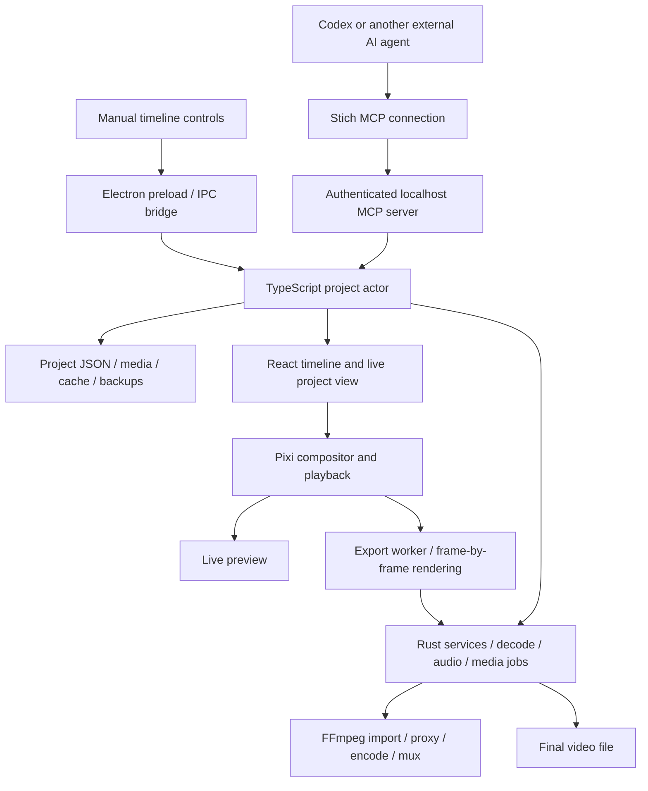

# How Stich works

Inspected on 5 October 2026 against the private Stich customization of WeftCut 0.3.0. Runtime code base: ccee07c9. This guide describes the existing system and proposes places to improve it; it does not claim those improvements are implemented.

## Where everything runs

Stich is a local Electron desktop editor. React and TypeScript provide the interface. Electron includes Chromium for the interface, GPU graphics and browser media APIs. Native Rust components run inside Electron through napi-rs. FFmpeg and optional inference engines run as native components or child processes.

The installed application and video files run on Osiris's Mac. Codex is the external AI agent; it sends structured editing commands to Stich. The VPS holds the source checkout and Linux development build. It does not currently serve the editor or render the Mac's video. No production web backend, account service or database server was deployed for this setup.

The diagram groups two Rust addons and several media APIs for readability. Heavy native work is not performed inside React event handlers.

## The layers and their responsibilities

| Layer | Owns | Where to look |
| --- | --- | --- |
| Desktop interface | Timeline, panels, settings, selection and playback controls | apps/desktop/src/renderer |
| Electron main | App lifecycle, window/profile settings, filesystem permissions, IPC and MCP hosting | apps/desktop/src/main/index.ts |
| Project actor | The authoritative project, validated edits, undo/history, checkpoints and edit notifications | apps/desktop/src/main/state/actor.ts and ts-actor-host.ts |
| Native Rust services | Import jobs, proxies, waveforms, audio preparation/mixing, speech calls and export sink | apps/desktop/native/src |
| Native decoder | FFmpeg-based decoding, including hardware lanes such as VideoToolbox on macOS | apps/desktop/native/decode/src |
| Compositor | Draws pictures, text, transforms, transitions, effects and nested compositions | apps/desktop/src/renderer/render/Compositor.ts and CompositionNode.ts |
| Export worker | Advances through output frames, renders them and streams them to an encoder | apps/desktop/src/renderer/render/worker |
| External AI | Chooses edits from the user's goal and the media information available to it | Codex plus skills/stich/SKILL.md |

The Rust core is not the owner of the project. The authoritative state is the TypeScript actor in Electron main. Rust receives the state slice needed for each computation, and background-job results are reconciled through the actor.

## What happens when an edit is made

1. A manual gesture or AI tool call requests a change, such as splitting a layer.
2. The actor serializes the request, checks its arguments and snaps times to the appropriate frame or audio-sample grid.
3. A valid change becomes one committed state, with an undo/history entry. Invalid changes are refused with a reason.
4. The UI receives the committed state. Autosave writes project.json after its debounce window, and periodic snapshots go into Backups.
5. Preview draws the updated composition. Export later renders from a project snapshot.

This common edit path keeps manual and AI work consistent. Future AI features should use these commands rather than modifying an open project's JSON behind the actor. Existing dry_run, checkpoints and readback provide useful boundaries for a proposed edit.

## What a project contains

The folder is the project. Project JSON records compositions, tracks, placed layers, media references, source trims, transforms, effects and settings. Source footage is separate from the instructions that arrange it.

Typical folders are Media, Cache and Backups. Caches contain preview proxies, thumbnails, waveforms and canonical audio. Large media files dominate storage. Small app/profile files hold preferences, recent projects and connection configuration.

Video timing is represented in integer microseconds and aligned to composition frames. Audio boundaries use the fixed 48 kHz sample grid. Rust's shared evaluation code also compiles to WASM so frame snapping, animation and audio-envelope calculations can share definitions across processes.

## Import and readiness

Import records/probes the source and launches background jobs. Jobs prepare whatever the chosen route needs: preview proxies or export intermediates, thumbnails, waveforms and decoded audio.

Audio preparation writes a canonical 48 kHz, 32-bit float PCM conform file. Preview and export use this prepared audio through their own playback/mixing mechanisms. A visible picture alone does not prove that audio, proxies and waveforms are ready.

Decode route describes the derivatives on disk. Decode-engine selection describes which decoder this machine uses now. They are separate: Standard uses native FFmpeg decoding; Lite uses WebCodecs; Automatic resolves from availability and source capability. Native macOS code includes a VideoToolbox hardware lane. Export resolves its decode routing at the beginning of a run.

## Preview and export

Preview must draw fast enough for real-time playback. Pixi assembles each image using GPU graphics. The editor has native and WebCodecs decode paths and preview-resolution controls.

Export reuses the composition/drawing logic in an offscreen worker, advances through the requested output frames and streams results with backpressure. This helps keep transforms, captions and effects consistent while keeping large videos out of one giant memory buffer. Export can make different decode/encode choices from preview; shared drawing code is not proof of byte-identical output.

The default encoder-engine setting resolves to the native FFmpeg sink. The worker composites and packs frames; FFmpeg encodes the frame stream. A WebCodecs encoder is an explicit alternative for supported delivery settings. Rust mixes audio, then FFmpeg encodes/muxes the final streams.

FFmpeg does not own the visual timeline compositor. Pixi draws the assembled video. FFmpeg handles media conversion, decoding components, encoding and container work.

Quality settings include output size/FPS, codec, bitrate or constant-quality mode, bit depth, audio settings and hardware/software encoding. A proxy is a derivative for performance or compatibility. Source selection and intermediate compression affect quality and should be verified independently from the editor's drawing code.

## Where the AI fits

The app exposes structured operations such as reading the project, importing media, trimming, splitting, adding captions and creating checkpoints. The running Stich app advertised 101 app tools during setup. The stdio connection bridge also offers compatibility status/launch helpers.

Codex connects through a local bridge to an authenticated localhost MCP endpoint. Each app has its own profile, port and bearer token. The AI edits the project visible in the app; it does not run a separate invisible timeline.

No general-purpose AI model was embedded by the rebrand. Optional speech and vision integrations are separate from Codex. Local engines need their binary and model assets; cloud backends need their own configuration and credentials. Current export is an app workflow, not an advertised MCP export tool.

A good autonomous editing workflow can add a decision layer around the existing tools: read transcript/audio/timeline, choose cuts according to the user's goal, show or rehearse the proposed changes, checkpoint, apply, read back and review. Removing quiet audio is a signal-processing operation; choosing which pause serves the story requires editorial context.

The previous Hinglish caption attempt used standalone Python/MLX Whisper scripts in Edit Notes. That work is separate from the built-in speech-backend integration. A durable caption flow needs suitable recognition, explicit backend selection, timing, Romanization/correction and a review step. Current user preference remains to skip captions.

## The changes with the clearest payoff

| Desired outcome | Likely area to change | Evidence of success |
| --- | --- | --- |
| An imported clip plays reliably | Job orchestration, readiness reporting and audio startup | Ready state matches usable audio/video; failures say which preparation step failed |
| Smooth editing on the 8 GB M2 Mac | Decode choice, preview resolution, buffers and cache scheduling | Compare dropped/late frames, memory and seek latency on the same saved cut |
| Cleaner spoken-video cuts | Agent decision workflow, pause policy and review markers | Audition sentence boundaries, preserved breaths and A/V alignment |
| Accurate Hinglish captions | Speech-backend integration and caption correction/review | Human-reviewed wording and word/cue alignment on a representative sample |
| Predictable final video quality | Export presets, source routing, color/encode validation | Check the actual MP4's frame count, resolution, color, duration, audio sync and appearance |
| Repeatable AI delivery | Tool contracts and workflow orchestration | Clear stage status, recoverable checkpoints and verifiable final artifacts |

For this machine/project, I would begin with reliable readiness and measured playback, then establish an export preset using a short rendered sample. Editing quality and captions should be evaluated separately against the user's desired story and wording.

The existing 9:39 cut opened in Stich with 37 video and 37 audio layers and unchanged composition records. A short playback check advanced beyond 37 seconds but reported 39 dropped and 74 late frames. Both editors were running; this is an observation, not a controlled benchmark or root-cause diagnosis. Full-video audio/export acceptance remains unverified.

## Infrastructure we currently maintain

- Installed private app: /Applications/Stich.app.
- Official app: /Applications/WeftCut.app.
- Private profile: ~/Library/Application Support/Stich.
- Private Codex connection/skill: stich.
- Public source: https://github.com/OsirisMedici/Stich.
- Future team/VPS support remains outside the Mac-first MVP.
- Customization code branch: codex/stich-branding.
- Private source remains based on WeftCut 0.3.0. MIT attribution and FFmpeg license/provenance materials are retained.
- The private installer is ad-hoc signed and not notarized; upstream automatic replacement is disabled.

The first private Mac package rebuilds the Electron code and reuses unchanged native Mac components from the matching official installation. Changing native source requires rebuilding those components instead. See STICH.md and scripts/stage-upstream-mac-native.mjs.

## Primary source references

- docs/architecture.md, docs/data-model.md, docs/mcp.md, docs/render.md and docs/audio.md.
- src/main/state/actor.ts, autosave.ts, ts-actor-host.ts and mutations/.
- src/main/mcp/index.ts and src/cli/paths.ts.
- src/renderer/render/worker/runExport.ts, encodeTarget.ts and exportSettings.ts.
- native/src/jobs/, native/src/audio/mix.rs, native/src/export/ and native/src/speech/.
- native/decode/src/backend.rs and preview_sw/decoder.rs.
- ADR 0030, 0033, 0036, 0068 and 0076.

Paths in the last two lists are relative to apps/desktop unless they begin with docs/. Older ADRs document earlier stages; current code was used to resolve changed defaults and macOS hardware support.
